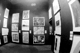
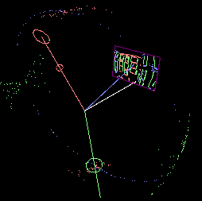
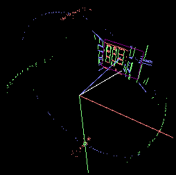
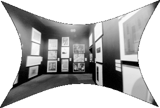
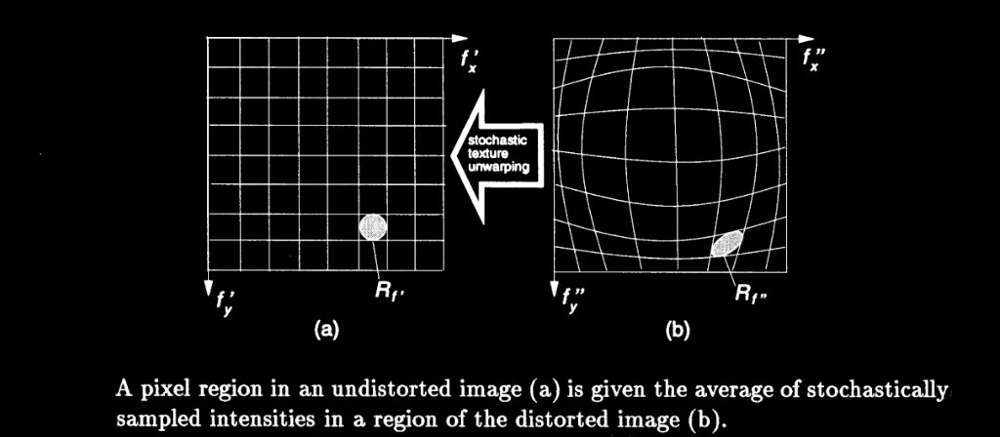

# Lens Distortion Estimation

Semiautomatic camera lens calibration from partially known structure, MIT Media Lab (1997). The calibration estimates three radial terms (K1, K2, K3) and two decentering terms (P1, P2). Curved images of straight edges become straight, and parallel lines meet at one vanishing point.

Page: http://alumni.media.mit.edu/~sbeck/results/Distortion/distortion.html

Dissertation: [Vision-assisted modeling for model-based video representations](https://dspace.mit.edu/entities/publication/a7a25f27-ed04-463d-97a4-eeada43179fd), Shawn C. Becker, MIT, February 1997.

## Distorted photograph

Fisheye photograph of the gallery before correction. Line segments are grouped into three scene directions.

Photograph by [Steve Mann](https://en.wikipedia.org/wiki/Steve_Mann_(inventor)).



## Calibration

For a point `(x, y)` at radius `r` from the image center, the distorted point `(x', y')` is

```
x' = x + x*(K1*r^2 + K2*r^4 + K3*r^6) + P1*(r^2 + 2*x^2) + 2*P2*x*y
y' = y + y*(K1*r^2 + K2*r^4 + K3*r^6) + P2*(r^2 + 2*y^2) + 2*P1*x*y
```

K1, K2, and K3 are radial. P1 and P2 are decentering.

## Gaussian segment points and focal point variances before correction

Each image segment is mapped from the center of projection onto the Gaussian sphere. Red, green, and blue are the three scene directions. The circle of each color is that direction's focal point, and the spread of the same-colored points is its variance.

Before correction the points of each color are widely dispersed. The red focal point lies toward the bottom of the sphere, the green focal point toward the right, and the blue focal point toward the top.



## Computed distortion parameters

The center of projection and the endpoints of each image segment are mapped to points and variances on the Gaussian sphere. Those variance-weighted points are normalized to compute a new position and a new variance for each vanishing point on the sphere. Gradient descent finds the distortion parameters that minimize the variance of the focal points on the Gaussian sphere.

For this gallery photograph the estimated parameters are

```
K1:  1.105763E-01
K2:  1.886214E-02
K3:  1.473832E-02
P1: -8.448460E-03
P2: -7.356744E-03
```

## Gaussian segment points and focal point variances after correction

With those parameters applied, the red, green, and blue points draw into tighter arcs. The variance around each focal point is smaller, and each focal point lies on the great circle for its scene direction.



## Corrected photograph

The same gallery photograph after the estimated distortion is removed. Edges that were curved are straight, and each set of parallel lines meets at one vanishing point.



## Stochastic texture unwarping

Pixels of the corrected image are sampled from regions of the distorted image (dissertation Figure 4-4).


