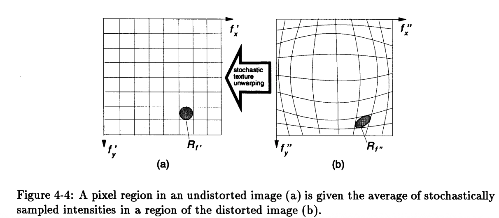

# Lens Distortion Estimation

Semiautomatic camera lens calibration from partially known structure, MIT Media Lab (1997). The calibration estimates three radial terms (K1, K2, K3) and two decentering terms (P1, P2) by minimizing vanishing-point dispersion. Curved images of straight edges become straight, and parallel lines meet at one vanishing point.

Page: http://alumni.media.mit.edu/~sbeck/results/Distortion/distortion.html

Dissertation: [Vision-assisted modeling for model-based video representations](https://dspace.mit.edu/entities/publication/a7a25f27-ed04-463d-97a4-eeada43179fd), Shawn C. Becker, MIT, February 1997.

## Calibration

For a point `(x, y)` at radius `r` from the image center, the distorted point `(x', y')` is

```
x' = x + x*(K1*r^2 + K2*r^4 + K3*r^6) + P1*(r^2 + 2*x^2) + 2*P2*x*y
y' = y + y*(K1*r^2 + K2*r^4 + K3*r^6) + P2*(r^2 + 2*y^2) + 2*P1*x*y
```

Estimation error is modeled as vanishing-point dispersion on a Gaussian sphere. Each image segment of a scene edge defines a plane through the center of projection. On the sphere, segments that belong to one set of parallel scene lines should lie on a great circle whose plane normal is the vanishing point. Lens distortion spreads those sphere points. The five parameters are the ones that minimize the weighted sum of those distances.

The published example on the alumni page estimated

```
K1:  1.105763E-01
K2:  1.886214E-02
K3:  1.473832E-02
P1: -8.448460E-03
P2: -7.356744E-03
```

## Photographs

The distorted and undistorted images show that estimation and correction on two different photographs taken with a fisheye lens. Photographs by [Steve Mann](https://en.wikipedia.org/wiki/Steve_Mann_(inventor)).

The gallery pair is on the alumni page:

- [distorted.gif](http://alumni.media.mit.edu/~sbeck/results/Distortion/distorted.gif) — before correction
- [undistorted.gif](http://alumni.media.mit.edu/~sbeck/results/Distortion/undistorted.gif) — after correction

A second pair, a road at night, is `distorted-50.png` and `undistorted-50.png`. Those two files are not on the alumni site.

The sphere plots on the same page are the dispersion diagnostic for the gallery photograph, not additional camera images:

- [sphere.distorted.gif](http://alumni.media.mit.edu/~sbeck/results/Distortion/sphere.distorted.gif) — vanishing-point dispersion before calibration
- [sphere.undistorted.gif](http://alumni.media.mit.edu/~sbeck/results/Distortion/sphere.undistorted.gif) — dispersion minimized after calibration

## Stochastic texture unwarping

Pixels of the unwarped image are sampled from regions of the distorted image. Figure 4-4 of the dissertation: a pixel region in the undistorted image (a) is given the average of stochastically sampled intensities in a region of the distorted image (b).


